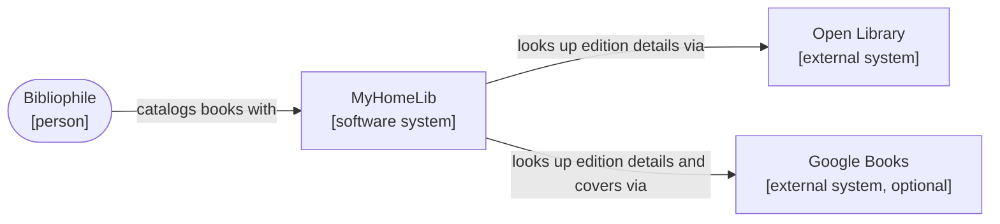
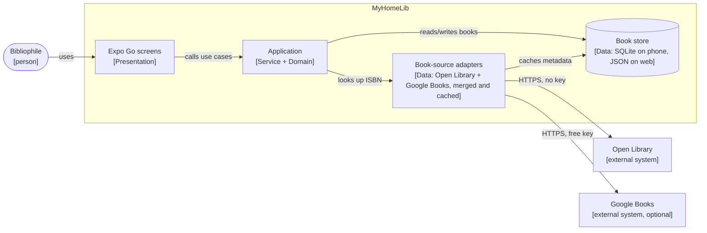
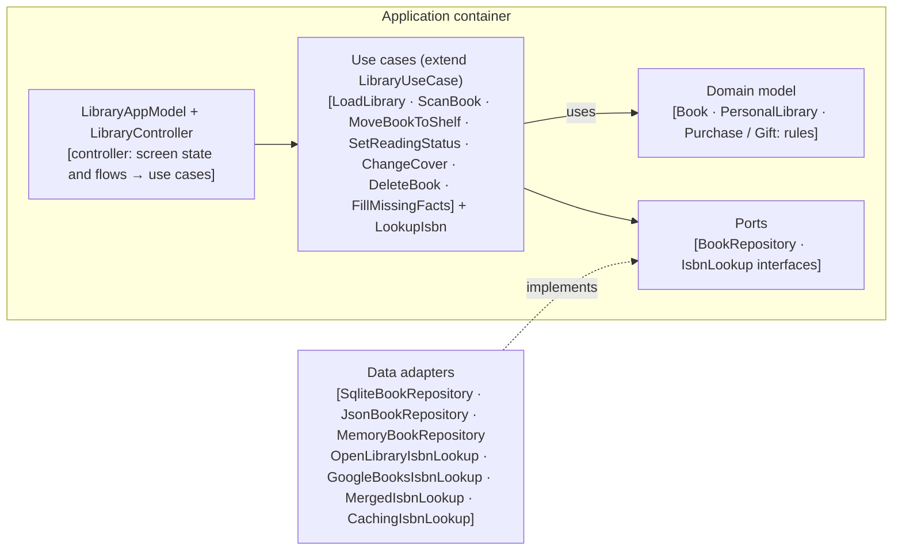
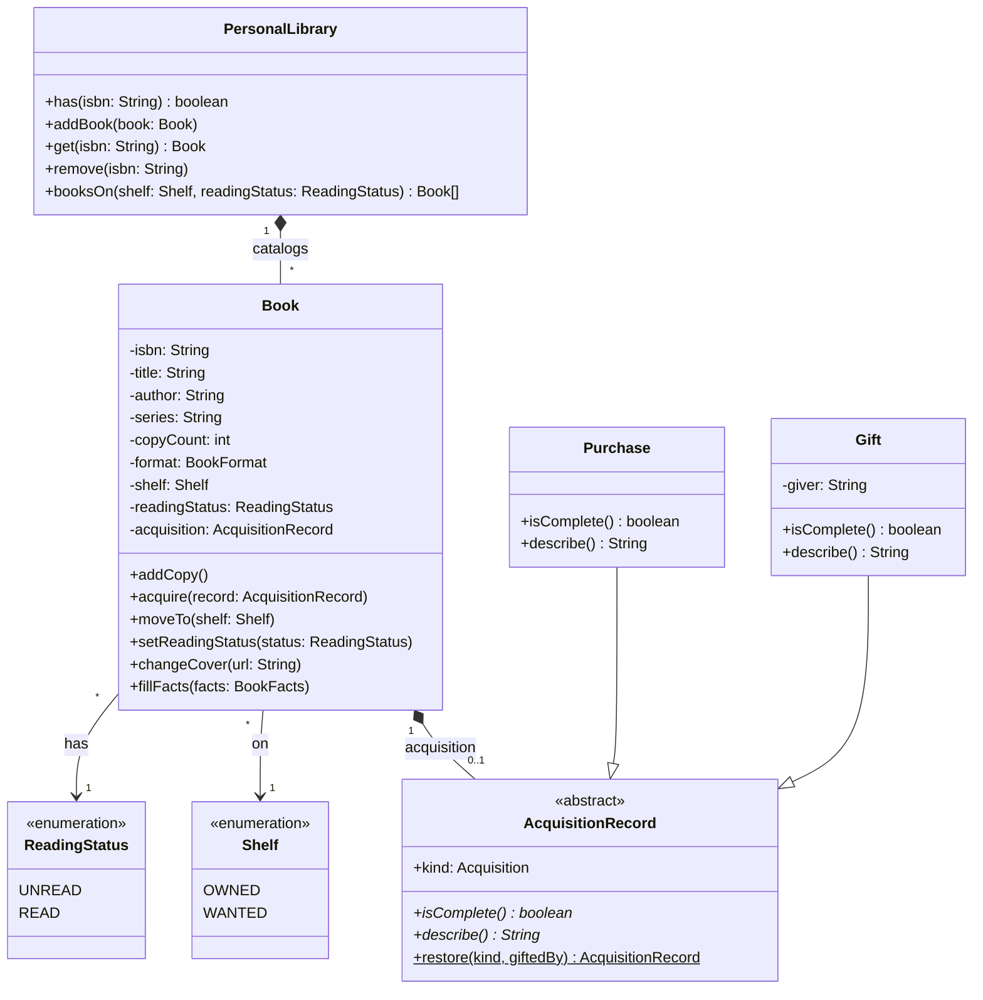
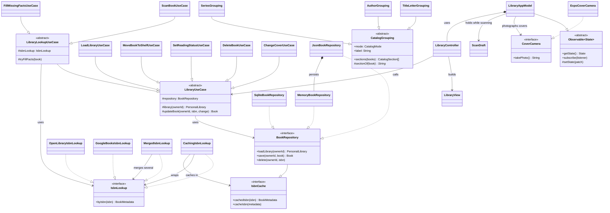
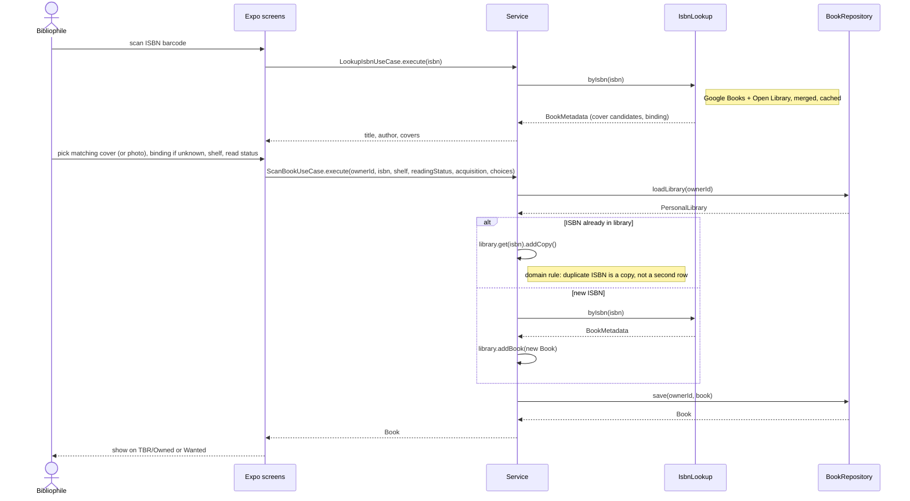

# MyHomeLib

**Student:** Grace Hechavarria · **Course:** CEN 5064 Software Design, Fall 2026 · **Partner:** [@YousufTheSWE]

## Project (approval paragraph)

```
MyHomeLib is a cross-platform Expo Go app (React Native) for bibliophiles who catalog a personal library. It runs on iPhone and Android through the free Expo Go client — not an App Store / Play binary, and not an Xcode or Android Studio project — so a partner can clone the repo and run it without a Mac. Conference fallback: Expo web in a browser (webcam ISBN scan). Core features: (1) ISBN camera scan (typed ISBN fallback) that looks up metadata from Open Library (the only external integration; no API key), including series, description, year, pages, and subjects, (2) Owned vs Wanted, with TBR as the Owned unread/read list and an Owned catalog (A–Z / author / series), and (3) Domain rules: scanning an ISBN already in the library increments a copy count instead of adding a second row; a Wanted book cannot move to Owned unless it is marked purchased or gifted (gifted requires the giver’s name). There is no bookstore web scraping.
```

## How to run

Requires Node.js LTS. No Python, no Xcode, no Android Studio, no paid developer account.

```
npm install
npm start
```

Optional, for exact covers: copy `.env.example` to `.env` and add a free Google Books API key (Google Cloud console → enable "Books API" → create an API key). Without it the app uses Open Library only ([ADR-006](docs/adr/adr-006.md)).

- Phone: install free **Expo Go**, then scan the QR code (same Wi-Fi, or use the tunnel option Expo prints). Open **Scan** and allow the camera; point it at the ISBN barcode on the book.


Tests: `npm test` (88 tests: every tier, every user flow through the view model, and the architecture rules).

## Documentation

| Document | What it's for |
|---|---|
| [`docs/design/main.pdf`](docs/design/main.pdf) | Software Design Document: architecture, components, interfaces, screenshots, requirements traceability, sprints, design rationale, and verification. LaTeX source and diagram sources sit beside it. |
| [`docs/code-review.md`](docs/code-review.md) | Study guide: what calls what in plain words, where each class lives and why, and answers to "why this architecture, why Expo Go, why TypeScript". |
| [`docs/adr/`](docs/adr/) | Architecture Decision Records (001–009): one page per decision, with its context and consequences. |
| This README | How to run, the tier table, and the C4 and UML diagrams. |

## Architecture

### Tier breakdown

| Tier | Responsibilities in THIS system |
|------|--------------------------------|
| Presentation | Expo Go screens: bottom menu **TBR / Owned / Wanted / Scan**, dark forest theme. TBR is the Owned reading list (Unread / Read). Owned is the full catalog, grouped A–Z, by Author, or by Series, with an A–Z letter rail in every grouping. Wanted is the wish list. Scan uses the camera or webcam, with a typed-ISBN fallback: confirm and **pick the cover that matches your copy** (or photograph it) → hardcover/paperback (only if no source knew) → Owned/Wanted → purchased/gifted (Owned only) → read/unread; a duplicate ISBN skips straight to adding a copy. Detail: edition facts and binding, read/unread, photograph my cover, shelf moves, delete. **Built MVVM:** `LibraryAppModel` (a class extending `Observable`) holds all screen state and flows; `LibraryController` is its bridge to the use cases; the device camera sits behind the `CoverCamera` interface. React components in `presentation/components/` only render, with every stylesheet in `presentation/styles/`. **Design system:** one theme file of tokens (colors, spacing, type roles in the Outfit font), shared building blocks (`Tappable` for every tap, `TextField`, `BookCover`, `CoverBackdrop`, `Logo`), and Expo Go's own modules for images, gradients, fonts and haptics ([ADR-008](docs/adr/adr-008.md)). Never touches a repository. |
| Service | Orchestration, one class per use case: `LookupIsbnUseCase` (no save), `ScanBookUseCase`, `LoadLibraryUseCase`, `MoveBookToShelfUseCase`, `SetReadingStatusUseCase`, `ChangeCoverUseCase`, `DeleteBookUseCase`, `FillMissingFactsUseCase`. All except the lookup extend the abstract `LibraryUseCase` (shared load → change → save); `ScanBookUseCase` and `FillMissingFactsUseCase` go through `LibraryLookupUseCase`, which adds the book-source lookup. The `UseCases` class builds them all from the two ports. Service never contains SQL, `fetch`, or React. |
| Domain | `Book` (isbn, title, author, cover, publisher, **format** HARDCOVER/PAPERBACK/UNKNOWN, shelf OWNED/WANTED, readingStatus UNREAD/READ, series, description, published, pageCount, subjects, copyCount, acquisition). TBR is a view of Owned unread/read, not a third exclusive shelf. Every Owned book must be purchased or gifted, whether it is scanned straight into Owned (`PersonalLibrary.addBook`) or moved from Wanted (`Book.moveTo`). |
| Data | Persistence and the two book sources. On a phone, `SqliteBookRepository` (`expo-sqlite`) stores each owner's books plus a lookup cache; on Expo web / tests, JSON / memory. `BookRowMapper` is the only row ↔ Book translation. Book sources: `OpenLibraryIsbnLookup` (no key; edition-first, so cover, publisher, date, pages and binding come from the exact ISBN's record) and `GoogleBooksIsbnLookup` (free key; only accepts the volume listing the scanned ISBN). `MergedIsbnLookup` asks both and keeps every distinct cover as a candidate; `CachingIsbnLookup` caches the result. All HTTP goes through the `Http` class. No bookstore scraping. |

### C4 Level 1 — Context

**What is this and who is it for?** One box for the system, the person who uses it, and the external systems it needs. Internals such as SQLite, the tiers, and shelves belong at Level 2.



### C4 Level 2 — Container

The separately running pieces inside MyHomeLib. They match the tier table above: **Presentation**, **Application (Service + Domain)**, and **Data**. Calls flow UI → Application → Data and never go backwards. Domain does not depend on Data.



### C4 Level 3 — Component (Application container, used lightly)

The Application container zoomed in, following the slide's Controller → Service → Domain / Repository shape:

- **Controller:** `LibraryAppModel` (screen state and flows) and `LibraryController` (its bridge to the use cases). `App.tsx` and `presentation/components/` only render and forward taps.
- **Services:** the use cases, which share the `LibraryUseCase` base class.
- **Repository:** the `BookRepository` / `IsbnLookup` interfaces (ports).

`CompositionRoot` (in `bootstrap.ts`) is the composition root. It plugs the Data adapters into the ports and hands the UI only use cases, so the UI never touches a repository and Service never imports Data. `tests/architecture.test.ts` enforces these rules.



### UML — Class diagram

The core domain classes and the attributes their rules use:

- Scanning a duplicate ISBN increments `copyCount` instead of adding a second row.
- An Owned book needs a complete `AcquisitionRecord`, whether it is scanned straight into Owned or moved from Wanted. A `Gift` is complete only when it has the giver's name.
- `ReadingStatus` is independent of `Shelf`.

`AcquisitionRecord` is abstract. `Purchase` and `Gift` each implement `isComplete()` and `describe()` their own way, so `Book` never needs an if/else on the acquisition type.



### UML — Class diagram (Service, Data, and Presentation structure)

How the other tiers are built from classes:

- **Inheritance:** every library use case extends `LibraryUseCase`, which holds the repository and the shared load → change → save steps (a template method). The two that also ask the book sources go one level deeper, through `LibraryLookupUseCase`.
- **Interfaces:** the ports are interfaces, and the Data adapters implement them.
- **Strategy:** each Owned-catalog grouping is a `CatalogGrouping` subclass.
- **Decorators:** `MergedIsbnLookup` combines the two book sources; `CachingIsbnLookup` caches whatever it wraps.
- **MVVM in Presentation:** `LibraryAppModel` extends the reusable `Observable` base class. React subscribes to it with `useObservable`, so components hold no logic.



### UML — Sequence diagram

The #1 use case is to scan a book. The lookup does not save anything. After the user confirms, `ScanBookUseCase` saves the book. Reading from top to bottom, calls flow UI → Service → Data and never go backwards. `->>` is a call, and `-->>` is a return.



## Architecture Decision Records

Decisions live in [`docs/adr/`](docs/adr/). Plain-English walkthrough and the "why" behind them: [`docs/code-review.md`](docs/code-review.md).

| # | Decision | Status |
|---|----------|--------|
| [001](docs/adr/adr-001.md) | TypeScript + Expo Go 4-tier monolith | accepted |
| [002](docs/adr/adr-002.md) | SQLite (device) / JSON fallback (web) | accepted |
| [003](docs/adr/adr-003.md) | Open Library for ISBN (no key) | accepted, amended by 006 |
| [004](docs/adr/adr-004.md) | No bookstore scraping | accepted |
| [005](docs/adr/adr-005.md) | Expo Go, not App Store / Xcode | accepted |
| [006](docs/adr/adr-006.md) | Google Books as a second book source (optional key) | accepted |
| [007](docs/adr/adr-007.md) | MVVM presentation: an observable view model, thin React views | accepted |
| [008](docs/adr/adr-008.md) | Design system: theme tokens, one stylesheet per component, shared UI building blocks | accepted |
| [009](docs/adr/adr-009.md) | Ports and adapters between Service and Data | accepted |

The full Software Design Document (LaTeX source and PDF) is in [`docs/design/`](docs/design/).

## Weekly log (optional but recommended)

- Week 1 (Aug 24): repo created, three ideas drafted
- Week 2 (Aug 31): Tier Breakdown  
- Week 3 (Sep 07): C4 Models / Architecture
- Week 4 ( Break ) ...
- Week 5 (Sep 21): Initial Architecture/Logic and Design Creation #3 Issue created. Changes pushed to a PR for review
- Week 6 (Sep 28): Enforce acquisition requirements when moving Wanted books to Owned #5 issue created, fixed and tested
- Week 7 (Oct 05): Exact-edition lookup (Google Books + Open Library merged, cover picker, own cover photo, binding question); OOP refactor (classes, MVVM, stylesheet imports); UI design system; Software Design Document v1.0
