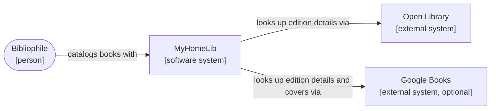
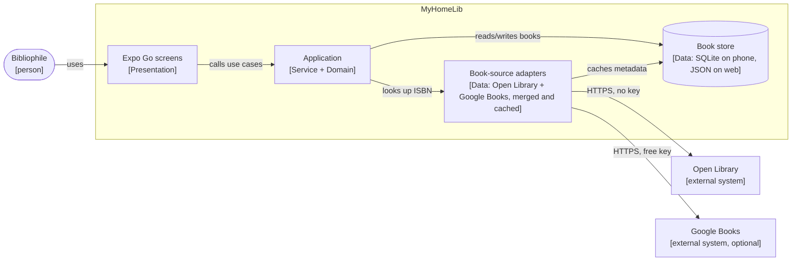
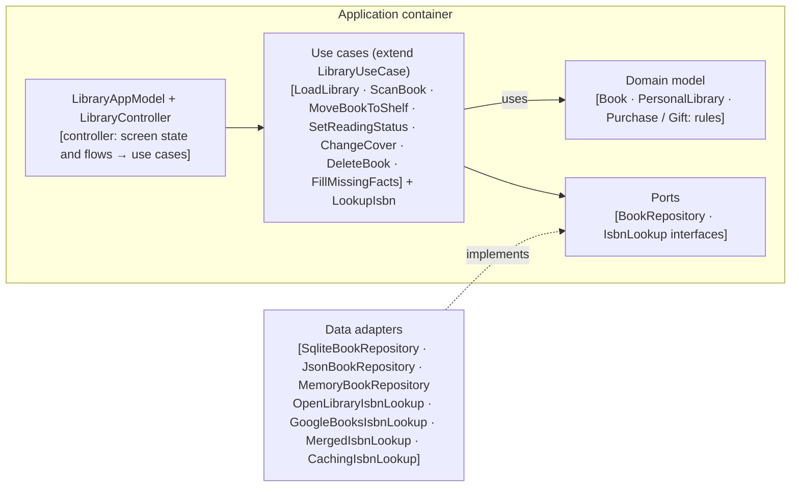
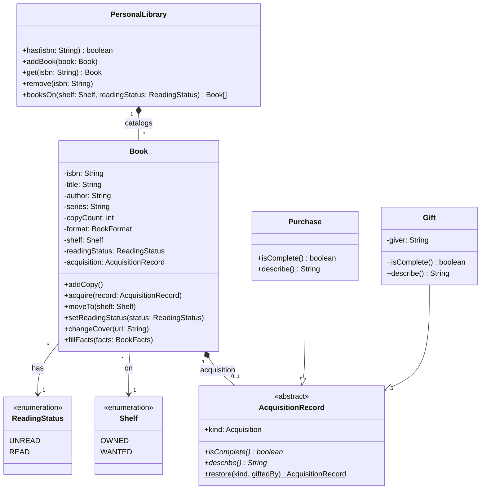
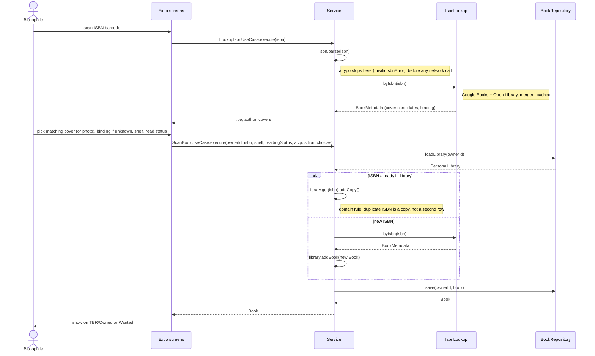

# MyHomeLib

[](https://github.com/ghechavarria/cen5064-project-hechavarria/actions/workflows/ci.yml)

**Student:** Grace Hechavarria · **Course:** CEN 5064 Software Design, Fall 2026 · **Partner:** [@YousufTheSWE]

## Project (approval paragraph)

```
MyHomeLib is a cross-platform Expo Go app (React Native) for bibliophiles who catalog a personal library. It runs on iPhone and Android through the free Expo Go client — not an App Store / Play binary, and not an Xcode or Android Studio project — so a partner can clone the repo and run it without a Mac. Conference fallback: Expo web in a browser (webcam ISBN scan). Core features: (1) ISBN camera scan (typed ISBN fallback) that looks up metadata from Open Library (the only external integration; no API key), including series, description, year, pages, and subjects, (2) Owned vs Wanted, with TBR as the Owned unread/read list and an Owned catalog (A–Z / author / series), and (3) Domain rules: scanning an ISBN already in the library increments a copy count instead of adding a second row; a Wanted book cannot move to Owned unless it is marked purchased or gifted (gifted requires the giver’s name). There is no bookstore web scraping.
```

**Scope changes since approval:** the bookstore price check was removed ([ADR-004](docs/adr/adr-004.md)), and Google Books was added as an optional second book source, through its official API, so scans match the exact edition ([ADR-006](docs/adr/adr-006.md)). The app still runs with Open Library alone. At the midterm check-in the scope was frozen, adding Google Account library sync as core feature 4 (below). Feature 4 was then built with email accounts instead of Google sign-in ([ADR-012](docs/adr/adr-012.md)): Google sign-in needs a custom native build, which is not free on iPhone, while email sign-in through Supabase runs inside Expo Go on both phones. Password reset is left out for now: on Supabase's free plan the reset email can't carry a code the app could use.

## Scope for the final

Nothing new will be added until these 4 core features are complete and tested.

1. **Scan a book:** Scan or type an ISBN to look up the exact edition from Open Library and Google Books, then pick the cover that matches your copy or photograph it.
2. **Shelve it, with rules enforced:** File the book as Owned or Wanted, and as read or unread. An Owned book must be marked purchased or gifted, and a gift needs the giver’s name. Scanning a book you already have adds a copy instead of a duplicate.
3. **Browse and manage your library:** See TBR (unread and read), the Owned catalog grouped A–Z, by author or by series, and the Wanted list. From a book’s page you can mark it read, move it, change its cover, or delete it.
4. **Account sign-in and library sync:** Sign in with your email and a password (required to see or add books) to keep your library backed up and in sync on all your phones, automatically. The phone's copy always works offline; the latest change to a book wins, and a book deleted on one phone is deleted on the others.

All 4 are built. Features 1–3 are tested end to end in [`tests/coreFeatures.test.ts`](tests/coreFeatures.test.ts); feature 4 in [`tests/sync.test.ts`](tests/sync.test.ts), [`tests/accounts.test.ts`](tests/accounts.test.ts) and [`tests/accountModel.test.ts`](tests/accountModel.test.ts), with no network needed.

## How to run

MyHomeLib is a mobile app. It runs on an iPhone or Android phone inside the free **Expo Go** app, served from your computer. No Xcode, no Android Studio, no paid developer account.

### What you need

- A computer (Windows, macOS or Linux) with [Node.js](https://nodejs.org/) **LTS** and [Git](https://git-scm.com/) installed. Check in a terminal: `node -v` and `git --version` should each print a version.
- An iPhone or Android phone on the **same Wi-Fi network** as the computer.
- A Google account (for the free Google Books API key in step 3).

### Steps

1. **Install Expo Go on your phone** from the App Store (iPhone) or Google Play (Android). If it is already installed, update it to the latest version: the project uses Expo SDK 58, and an older Expo Go says "Project is incompatible with this version of Expo Go".

2. **Download the project.** In a terminal:
   ```
   git clone https://github.com/ghechavarria/cen5064-project-hechavarria.git
   cd cen5064-project-hechavarria
   ```

3. **Get a Google Books API key** (free; scans use it to find the exact edition and its cover):
   1. Open the [Google Cloud console](https://console.cloud.google.com/) and sign in with your Google account.
   2. Create a project: click the project picker at the top → **New project** → type any name (for example `myhomelib`) → **Create**. Make sure the new project is selected in the picker.
   3. Turn on the API: menu ☰ → **APIs & Services** → **Library** → search **Books API** → open it → **Enable**.
   4. Create the key: **APIs & Services** → **Credentials** → **+ Create credentials** → **API key**. Copy the key it shows.
   5. Restrict the key: on the same page click the key's name → **API restrictions** → **Restrict key** → tick **Books API** → **Save**.

4. **Put the key in a `.env` file** in the project folder. Copy the example file:
   - Windows (Command Prompt or PowerShell): `copy .env.example .env`
   - macOS / Linux: `cp .env.example .env`

   Open `.env` in any text editor and paste your key after the `=` on this line, with no spaces or quotes:
   ```
   EXPO_PUBLIC_GOOGLE_BOOKS_KEY=your-key-here
   ```
   Save the file. Leave the two `EXPO_PUBLIC_SUPABASE_` lines empty. **You do not need a Supabase account or any Supabase keys:** accounts use the shared MyHomeLib project, whose address and public key are built into the app. `.env` is ignored by Git, so your Google key is never committed.

5. **Install the dependencies** (takes a minute or two the first time):
   ```
   npm install
   ```

6. **Start the app server:**
   ```
   npx expo start
   ```
   Leave this terminal open while you use the app. It prints a QR code. On Windows, if a firewall window asks about Node.js, click **Allow** (private networks), or the phone can't reach the computer.

7. **Open the app on your phone:**
   - Open Expo Go. Under **Development servers**, tap the MyHomeLib server.
   - If it isn't listed, scan the QR code from the terminal: on iPhone with the **Camera** app, on Android with **Scan QR code** inside Expo Go.
   - On iPhone, when Expo Go asks to find devices on your local network, tap **Allow**.
   - The first load takes up to a minute while the app is built.

8. **Create an account.** The library is kept in your account, so the shelves stay empty and scanning is off until you sign in. Tap the **Account** tab → **Create an account** → enter your email and a password of at least 8 characters → **Create account**. You are signed in straight away, with no confirmation email. Next time (or on another phone), use **Sign in** with the same email and password. **Sign out** is on the same tab.

9. **Scan a book.** Tap **Scan**, allow the camera, and point it at the ISBN barcode on the back of a book (or type the ISBN below the camera). Pick the cover that matches your copy, then answer the questions to shelve it.

### If something goes wrong

| Problem | Fix |
|---|---|
| The phone doesn't list the server, or the QR code won't open | Check the phone and computer are on the same Wi-Fi. Otherwise stop the server (Ctrl+C) and run `npx expo start --tunnel` (say yes if it asks to install `@expo/ngrok`), then scan the new QR code. |
| Scans find nothing or show no covers after editing `.env` | Stop the server (Ctrl+C) and start it again with `npx expo start --clear`, so the key is read. |
| `npm install` or `npx` is not recognized | Install Node.js LTS, then close and reopen the terminal. |
| "Couldn't reach the account service" when signing in | Check the phone's internet connection. If it persists, the shared Supabase project may be paused after a week without use: ask the project owner to restore it (see below). |
| "An account with that email already exists" | Use **Sign in** instead of **Create an account**. |

### Running the Supabase project (project owner only)

People who run the app never do this. It is how the shared project behind the accounts was set up, and how to set up your own ([ADR-012](docs/adr/adr-012.md)):

1. At [supabase.com](https://supabase.com), create a free project. Keep **Enable Data API** on, turn **Automatically expose new tables** off, and turn **Enable automatic RLS** on.
2. **SQL Editor** → **New query** → paste all of [`supabase/migrations/20261107000000_library_books.sql`](supabase/migrations/20261107000000_library_books.sql) → **Run**. It creates the `library_books` table, its row level security rules, and turns on Realtime for auto sync.
3. **Authentication** → **Sign In / Providers**: keep **Email** enabled, turn **Confirm email** off, and **Save changes** (the free plan's email sender only reaches the project's own team).
4. To point the app at your project, put its **Project URL** and **Publishable key** (Project Settings → API Keys) in `.env` as `EXPO_PUBLIC_SUPABASE_URL` and `EXPO_PUBLIC_SUPABASE_KEY`. Never use the secret or `service_role` key.
5. Free projects pause after about a week without activity. If sign-in stops working, open the dashboard and click **Restore project**.

**Web browser (limited):** the app also runs in a browser (press `w` in the terminal after `npx expo start`), but full functionality is only available on mobile. The web version has no camera, so you type the ISBN instead of scanning it and cannot take cover photos. Accounts and sync work in the browser too.

**Tests:** `npm test` runs 195 tests: each core feature end to end, every tier, every user flow through the view models, SQLite and JSON persistence, sync between two phones, bad input and network failures, and the architecture rules.

## Documentation

| Document | What it's for |
|---|---|
| [`docs/design/DesignDocument_Hechavarria.pdf`](docs/design/DesignDocument_Hechavarria.pdf) | Software Design Document: architecture, components, interfaces, screenshots, requirements traceability, sprints, design rationale, and verification. A Word copy ([`DesignDocument_Hechavarria.docx`](docs/design/DesignDocument_Hechavarria.docx)), the LaTeX source (`DesignDocument_Hechavarria.tex`), and the diagram sources sit beside it. |
| [`docs/code-review.md`](docs/code-review.md) | Study guide: what calls what in plain words, where each class lives and why, and answers to "why this architecture, why Expo Go, why TypeScript". |
| [`docs/pattern-map.md`](docs/pattern-map.md) | The five creational patterns checked against this code: one genuine fit (Abstract Factory) and four honest "no fit" lines. |
| [`docs/adr/`](docs/adr/) | Architecture Decision Records (001–012): one page per decision, with its context and consequences. |
| This README | How to run, the tier table, and the C4 and UML diagrams. |

## Architecture

### Tier breakdown

| Tier | Responsibilities in THIS system |
|------|--------------------------------|
| Presentation | Expo Go screens: bottom menu **TBR / Owned / Wanted / Scan / Account**, dark forest theme. Account signs in or creates an account and shows how the last sync went (`AccountModel`, ADR-012). TBR is the Owned reading list (Unread / Read). Owned is the full catalog, grouped A–Z, by Author, or by Series, with an A–Z letter rail in every grouping. Wanted is the wish list. Scan uses the phone camera, with a typed-ISBN fallback: confirm and **pick the cover that matches your copy** (or photograph it) → hardcover/paperback (only if no source knew) → Owned/Wanted → purchased/gifted (Owned only) → read/unread; a duplicate ISBN skips straight to adding a copy. Detail: edition facts and binding, read/unread, photograph my cover, shelf moves, delete. **Built MVVM:** `LibraryAppModel` (a class extending `Observable`) holds all screen state and flows; `LibraryController` is its bridge to the use cases; the camera and haptic feedback come from one device family (`PhoneDevices` or `BrowserDevices`, an Abstract Factory chosen once in `App.tsx`; see [docs/pattern-map.md](docs/pattern-map.md)). React components in `presentation/components/` only render, with every stylesheet in `presentation/styles/`. **Design system:** one theme file of tokens (colors, spacing, type roles in the Outfit font), shared building blocks (`Tappable` for every tap, `TextField`, `BookCover`, `CoverBackdrop`, `Logo`), and Expo Go's own modules for images, gradients, fonts and haptics ([ADR-008](docs/adr/adr-008.md)). Never touches a repository. |
| Service | Orchestration, one class per use case: `LookupIsbnUseCase` (no save), `ScanBookUseCase`, `LoadLibraryUseCase`, `MoveBookToShelfUseCase`, `SetReadingStatusUseCase`, `ChangeCoverUseCase`, `DeleteBookUseCase`, `FillMissingFactsUseCase`. All except the lookup extend the abstract `LibraryUseCase` (shared load → change → save); `ScanBookUseCase` and `FillMissingFactsUseCase` go through `LibraryLookupUseCase`, which adds the book-source lookup. The `UseCases` class builds them all from the two ports. Service never contains SQL, `fetch`, or React. |
| Domain | `Book` (isbn, title, author, cover, publisher, **format** HARDCOVER/PAPERBACK/UNKNOWN, shelf OWNED/WANTED, readingStatus UNREAD/READ, series, description, published, pageCount, subjects, copyCount, acquisition). TBR is a view of Owned unread/read, not a third exclusive shelf. Every Owned book must be purchased or gifted, whether it is scanned straight into Owned (`PersonalLibrary.addBook`) or moved from Wanted (`Book.moveTo`). |
| Data | Persistence and the two book sources. On a phone, `SqliteBookRepository` (`expo-sqlite`) stores each owner's books plus a lookup cache; on Expo web / tests, JSON / memory. `BookRowMapper` is the only row ↔ Book translation, and repairs rows saved by older builds or damaged on disk. Rows are unique per owner and ISBN. Book sources: `OpenLibraryIsbnLookup` (no key; edition-first, so cover, publisher, date, pages and binding come from the exact ISBN's record) and `GoogleBooksIsbnLookup` (free key; only accepts the volume listing the scanned ISBN). `MergedIsbnLookup` asks both and keeps every distinct cover as a candidate; `CachingIsbnLookup` caches the result. All HTTP goes through the `Http` class, which times out after 15 s and reports any failure as one `BookSourceUnavailableError`. No bookstore scraping. |

### C4 Level 1 — Context

**What is this and who is it for?** One box for the system, the person who uses it, and the external systems it needs. Internals such as SQLite, the tiers, and shelves belong at Level 2.



### C4 Level 2 — Container

The separately running pieces inside MyHomeLib. They match the tier table above: **Presentation**, **Application (Service + Domain)**, and **Data**. Calls flow UI → Application → Data and never go backwards. Domain does not depend on Data.



### C4 Level 3 — Component (Application container, used lightly)

The Application container zoomed in, following the slide's Controller → Service → Domain / Repository shape:

- **Controller:** `LibraryAppModel` (screen state and flows) and `LibraryController` (its bridge to the use cases). `App.tsx` and `presentation/components/` only render and forward taps.
- **Services:** the use cases, which share the `LibraryUseCase` base class.
- **Repository:** the `BookRepository` / `IsbnLookup` interfaces (ports).

`CompositionRoot` (in `bootstrap.ts`) is the composition root. It plugs the Data adapters into the ports and hands the UI only use cases, so the UI never touches a repository and Service never imports Data. `tests/architecture.test.ts` enforces these rules.



### UML — Class diagram

The core domain classes and the attributes their rules use:

- Scanning a duplicate ISBN increments `copyCount` instead of adding a second row.
- An Owned book needs a complete `AcquisitionRecord`, whether it is scanned straight into Owned or moved from Wanted. A `Gift` is complete only when it has the giver's name.
- `ReadingStatus` is independent of `Shelf`.

`AcquisitionRecord` is abstract. `Purchase` and `Gift` each implement `isComplete()` and `describe()` their own way, so `Book` never needs an if/else on the acquisition type.



### UML — Class diagram (Service, Data, and Presentation structure)

How the other tiers are built from classes:

- **Inheritance:** every library use case extends `LibraryUseCase`, which holds the repository and the shared load → change → save steps (a template method). The two that also ask the book sources go one level deeper, through `LibraryLookupUseCase`.
- **Interfaces:** the ports are interfaces, and the Data adapters implement them.
- **Strategy:** each Owned-catalog grouping is a `CatalogGrouping` subclass.
- **Decorators:** `MergedIsbnLookup` combines the two book sources; `CachingIsbnLookup` caches whatever it wraps.
- **MVVM in Presentation:** `LibraryAppModel` extends the reusable `Observable` base class. React subscribes to it with `useObservable`, so components hold no logic.

```mermaid
classDiagram
    class LibraryUseCase {
        <<abstract>>
        #repository: BookRepository
        #library(ownerId) PersonalLibrary
        #updateBook(ownerId, isbn, change) Book
    }
    class LibraryLookupUseCase {
        <<abstract>>
        #isbnLookup: IsbnLookup
        #tryFillFacts(book)
    }
    LoadLibraryUseCase --|> LibraryUseCase
    MoveBookToShelfUseCase --|> LibraryUseCase
    SetReadingStatusUseCase --|> LibraryUseCase
    DeleteBookUseCase --|> LibraryUseCase
    ChangeCoverUseCase --|> LibraryUseCase
    LibraryLookupUseCase --|> LibraryUseCase
    ScanBookUseCase --|> LibraryLookupUseCase
    FillMissingFactsUseCase --|> LibraryLookupUseCase

    class IsbnCache {
        <<interface>>
        +cachedIsbn(isbn) BookMetadata
        +cacheIsbn(metadata)
    }
    class BookRepository {
        <<interface>>
        +loadLibrary(ownerId) PersonalLibrary
        +save(ownerId, book) Book
        +delete(ownerId, isbn)
    }
    class IsbnLookup {
        <<interface>>
        +byIsbn(isbn) BookMetadata
    }
    MemoryBookRepository ..|> IsbnCache
    JsonBookRepository ..|> IsbnCache
    SqliteBookRepository ..|> IsbnCache
    LibraryUseCase --> BookRepository : uses
    LibraryLookupUseCase --> IsbnLookup : uses
    MemoryBookRepository ..|> BookRepository
    JsonBookRepository ..|> BookRepository
    SqliteBookRepository ..|> BookRepository
    JsonBookRepository *-- MemoryBookRepository : persists
    OpenLibraryIsbnLookup ..|> IsbnLookup
    GoogleBooksIsbnLookup ..|> IsbnLookup
    MergedIsbnLookup ..|> IsbnLookup
    MergedIsbnLookup --> IsbnLookup : merges several
    CachingIsbnLookup ..|> IsbnLookup
    CachingIsbnLookup --> IsbnLookup : wraps
    CachingIsbnLookup --> IsbnCache : caches in

    class CatalogGrouping {
        <<abstract>>
        +mode: CatalogMode
        +label: String
        +sections(books) CatalogSection[]
        #sectionOf(book)* String
    }
    TitleLetterGrouping --|> CatalogGrouping
    AuthorGrouping --|> CatalogGrouping
    SeriesGrouping --|> CatalogGrouping
    class Observable~State~ {
        <<abstract>>
        +getState() State
        +subscribe(listener)
        #setState(patch)
    }
    class CoverCamera {
        <<interface>>
        +available: boolean
        +takePhoto() String
    }
    class Feedback {
        <<interface>>
        +selection()
        +message(failed)
    }
    class DeviceFamily {
        <<interface>>
        +createCoverCamera() CoverCamera
        +createFeedback() Feedback
    }
    LibraryAppModel --|> Observable~State~
    LibraryAppModel --> DeviceFamily : takes one family
    LibraryAppModel --> CoverCamera : photographs covers
    LibraryAppModel --> Feedback : ticks and buzzes
    PhoneDevices ..|> DeviceFamily
    BrowserDevices ..|> DeviceFamily
    PhoneDevices --> ExpoCoverCamera : creates
    PhoneDevices --> HapticFeedback : creates
    BrowserDevices --> BrowserCoverCamera : creates
    BrowserDevices --> SilentFeedback : creates
    ExpoCoverCamera ..|> CoverCamera
    BrowserCoverCamera ..|> CoverCamera
    HapticFeedback ..|> Feedback
    SilentFeedback ..|> Feedback
    LibraryAppModel --> ScanDraft : holds while scanning
    LibraryAppModel *-- LibraryController : uses
    LibraryController --> LibraryView : builds
    LibraryController --> LibraryUseCase : calls
```



### UML — Sequence diagram

The #1 use case is to scan a book. The lookup does not save anything. After the user confirms, `ScanBookUseCase` saves the book. Reading from top to bottom, calls flow UI → Service → Data and never go backwards. `->>` is a call, and `-->>` is a return.



## Architecture Decision Records

Decisions live in [`docs/adr/`](docs/adr/). Plain-English walkthrough and the "why" behind them: [`docs/code-review.md`](docs/code-review.md).

| # | Decision | Status |
|---|----------|--------|
| [001](docs/adr/adr-001.md) | TypeScript + Expo Go 4-tier monolith | accepted |
| [002](docs/adr/adr-002.md) | SQLite (device) / JSON fallback (web) | accepted |
| [003](docs/adr/adr-003.md) | Open Library for ISBN (no key) | accepted, amended by 006 |
| [004](docs/adr/adr-004.md) | No bookstore scraping | accepted |
| [005](docs/adr/adr-005.md) | Expo Go, not App Store / Xcode | accepted |
| [006](docs/adr/adr-006.md) | Google Books as a second book source (optional key) | accepted |
| [007](docs/adr/adr-007.md) | MVVM presentation: an observable view model, thin React views | accepted |
| [008](docs/adr/adr-008.md) | Design system: theme tokens, one stylesheet per component, shared UI building blocks | accepted |
| [009](docs/adr/adr-009.md) | Ports and adapters between Service and Data | accepted |
| [010](docs/adr/adr-010.md) | Validate input and contain failures at the tier edges | accepted |
| [011](docs/adr/adr-011.md) | Device services as one family per platform (Abstract Factory) | accepted |

The full Software Design Document (PDF, Word copy, and LaTeX source) is in [`docs/design/`](docs/design/).

## Weekly log (optional but recommended)

- Week 1 (Aug 24): repo created, three ideas drafted
- Week 2 (Aug 31): Tier Breakdown  
- Week 3 (Sep 07): C4 Models / Architecture (drafted this week; committed Sep 14)
- Week 4 (Sep 14): Break week. Only the week-3 C4 and class diagrams were committed, on Sep 14.
- Week 5 (Sep 21): Initial Architecture/Logic and Design Creation #3 Issue created. Changes pushed to a PR for review
- Week 6 (Sep 28): Enforce acquisition requirements when moving Wanted books to Owned #5 issue created, fixed and tested
- Week 7 (Oct 05): Exact-edition lookup (Google Books + Open Library merged, cover picker, own cover photo, binding question); OOP refactor (classes, MVVM, stylesheet imports); UI design system; Software Design Document v1.0; CI added. Honest note: this week's work was built locally and pushed as one large PR (#8, closes #7) instead of in daily commits. From week 8 on, each issue gets its own branch and smaller commits.
- Week 8 (Oct 12): Midterm check-in. Scope for the final frozen to 4 core features (adds Google Account library sync, planned for weeks 10–11). Hardening: ISBN check-digit validation with one ISBN-13 key per book, a timeout and one clear error for unreachable book sources, recovery from damaged storage, books unique per owner (ADR-010). Mobile-first run instructions. 145 tests, including one end-to-end test file per core feature.
- Week 11 (Nov 02): SOLID refactor, Interface Segregation (BookRepository split from IsbnCache, PR #16). Creational pattern map (docs/pattern-map.md): one genuine fit, Abstract Factory for the device services (PhoneDevices / BrowserDevices, ADR-011), and four honest "no fit" lines. 151 tests. Design document (#18): every diagram made readable when printed (from 2.6–5.8pt to at least 7pt), a one-page Key Design Decisions section up front, and repeated tables and figures removed. Core feature 4 built (#13, ADR-012): email accounts through Supabase instead of Google sign-in (not free on iPhone in Expo Go), library sync where the latest change wins and deletes travel as tombstones, auto sync through Supabase Realtime, and sign-in required to see or scan books. Password reset left out (the free plan can't put a code in the email). Upgraded to Expo SDK 58 after Expo Go updated. README run steps rewritten so a fresh clone runs with only a Google Books key. 195 tests. Outstanding: a delete made in the browser reached the other device only after Sync now. Not yet updated for feature 4: the C4/UML diagrams and the design document.
