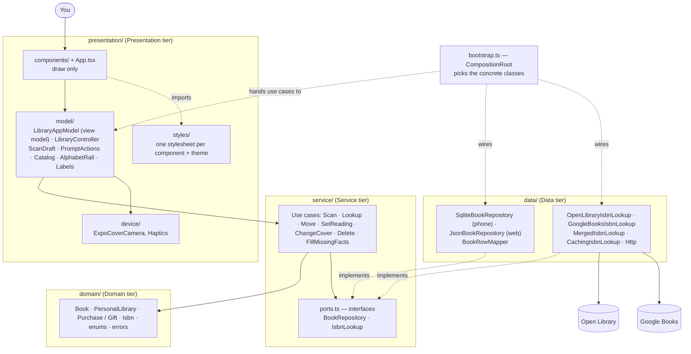
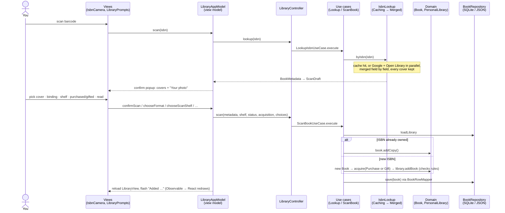
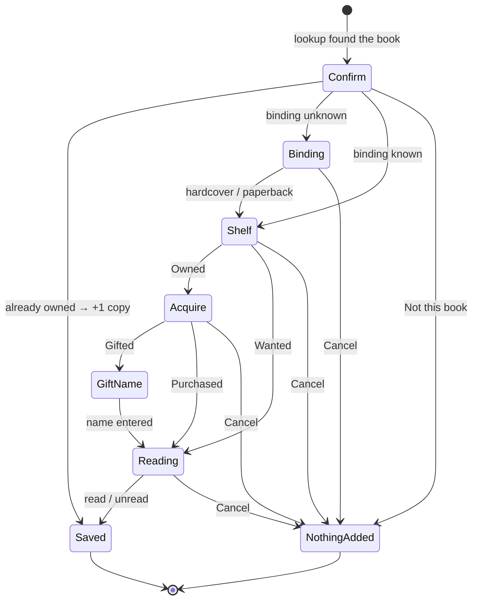
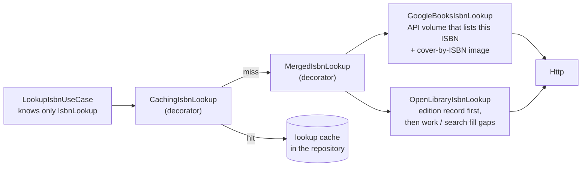
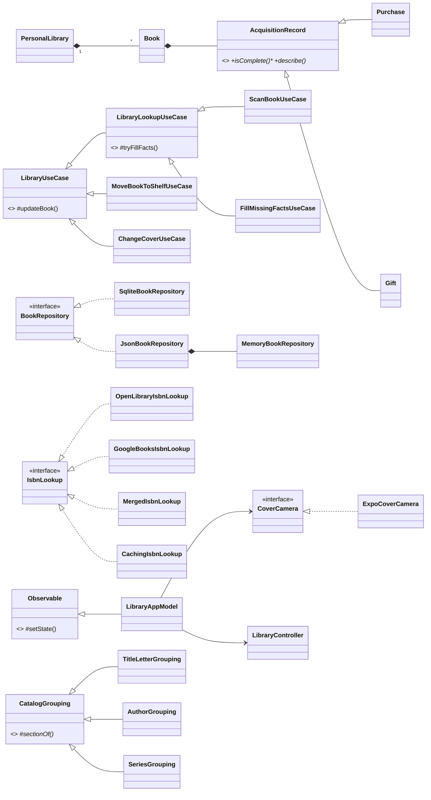

# MyHomeLib — study guide (1,000-foot view)

Scan a book's ISBN, get the **exact edition** (publisher, binding, cover) from Open Library and Google Books, and file it as **Owned** or **Wanted**. TBR is your Owned books split into unread and read. The rules live in the domain: a duplicate ISBN adds a copy; every Owned book must be Purchased or Gifted; a gift needs the giver's name.

Decisions and their reasons: [`docs/adr/`](adr/). Full C4/UML set: [`README.md`](../README.md). The Software Design Document (all diagrams, requirements traceability, sprints, and verification with screenshots): [`docs/design/DesignDocument_Hechavarria.pdf`](design/DesignDocument_Hechavarria.pdf); its diagram sources are in `docs/design/diagrams/`.

---

## 1. The big picture: tiers, folders, and who may call whom

**The one rule:** arrows only point down. Service never imports Data; it only knows the *interfaces* in `ports.ts`, and Data implements them (dependency inversion). Domain imports nothing. The UI never touches a repository or `fetch`. `tests/architecture.test.ts` **fails the build** if any of that is broken, or if a component writes its own styles.

---

## 2. What calls what, in plain words

**The one-sentence version:** the screen asks the view model, the view model asks the controller, the controller asks one use case, and the use case asks the domain (the rules) and the repository (the storage). The answer flows back up, and the screen redraws.

**Who does what (an analogy):**

| Part | Plain-English job | Like… |
|---|---|---|
| Components (`presentation/components/`) | Draw the screen and pass on your taps. Never decide anything. | The front desk |
| `LibraryAppModel` | The screen's brain: remembers which tab and popup are open, which question comes next, and the message to show. | The desk manager |
| `LibraryController` | Turns "the user wants X" into a call to the right use case. | The messenger |
| Use cases (`service/`) | One job each ("scan a book", "move a book"): load the library, change it, save it. | A clerk with one task |
| Domain (`Book`, `PersonalLibrary`, `Purchase` / `Gift`) | The rules: a duplicate is a copy; Owned needs a purchase or a gift; a gift needs a name. | The rulebook |
| Ports (`service/ports.ts`) | The shapes the use cases expect to plug into ("something that can save books", "something that can look up an ISBN"). | Wall sockets |
| Repositories (`data/`) | Save and load books: SQLite on a phone, browser storage on the web. | The filing cabinet |
| Book sources (`data/`) | Look up an ISBN on Open Library and Google Books. | The reference librarians |
| `CompositionRoot` (`bootstrap.ts`) | At start-up, plugs the real cabinet and librarians into the sockets. | The electrician |

**When the app opens:**
1. `index.ts` registers `App.tsx` with Expo.
2. `App.tsx` creates `LibraryAppModel`, handing it a recipe for its controller, and calls `model.start()`.
3. `start()` runs the recipe: `CompositionRoot.openUseCases()` opens the database, sets up the book sources (Google only if there's a key), and builds the `UseCases`, which go into a new `LibraryController`.
4. `start()` then calls `controller.view()` → `LoadLibraryUseCase` → `repository.loadLibrary()`. The shelves land in the model's state, and the screen draws them.
5. Last, it quietly fills in any missing edition facts (`FillMissingFactsUseCase`) and redraws.

**When you tap anything (every action follows this path):**
1. The component calls a method on the model, e.g. `moveSelected(OWNED)`.
2. If the model needs an answer from you first, it opens a popup and waits ("How did you get it?").
3. The model calls the controller, which calls one use case.
4. The use case loads the library, calls a domain method (the rules are checked there), and saves.
5. The model reloads the shelves into its state. Because it is an `Observable`, every change notifies React (through `useObservable`), and the screen redraws.

**When something goes wrong:** the domain throws a named error (for example `NotAcquiredError`). Every library action goes through the model's `run()`, which catches the error in one place and shows it in the message banner (a broken rule as a normal notice, anything unexpected in red); nothing is saved.

**What never happens:** a screen never talks to the database or the internet, a use case never imports SQLite or `fetch`, and the domain never imports anything. `tests/architecture.test.ts` fails if anyone tries.

---

## 3. Where code lives, and why there

| Folder | Holds | Why it lives here |
|---|---|---|
| `domain/` | `Book`, `PersonalLibrary`, `AcquisitionRecord` → `Purchase` / `Gift`, `Isbn`, enums, typed errors | **The rules.** Nothing external is imported, so nothing can bypass them, and they're tested in isolation. |
| `service/` | One class per use case. Base classes `LibraryUseCase` → `LibraryLookupUseCase`. `UseCases` builds them all. `ports.ts` holds the interfaces. | **Orchestration:** load → apply domain methods → save. It depends on interfaces, so storage and sources can change freely. |
| `data/` | Repositories (SQLite, JSON, Memory), `BookRowMapper`, book sources (Open Library, Google), decorators (`Merged`, `Caching`), `Http` | **The outside world.** The only place SQL and HTTP exist. |
| `bootstrap.ts` | `CompositionRoot` | **The only place concrete classes are named:** SQLite vs JSON, Google only if a key exists. |
| `presentation/model/` | `LibraryAppModel` (all screen state and flows), `LibraryController`, `LibraryView`, `ScanDraft`, `CoverCamera`, `PromptActions`, `Catalog`, `AlphabetRail`, `Labels`, plus the `useObservable` and `useReducedMotion` hooks | **Screen logic as plain classes.** No React, so every flow is unit-tested. |
| `presentation/device/` | `ExpoCoverCamera`, `Haptics` | Phone hardware: the camera (behind the `CoverCamera` interface) and the vibration motor (tab ticks, error buzz; silent on web). |
| `presentation/components/` + `App.tsx` | Views: `LibraryPrompts`, `CoverPicker`, `BookDetail`, `OwnedCatalog`, `LetterRail`, `ScreenHeader` (logo or round Back, title, hint, fading rule), `MenuBar` (sliding pill, Scan as the mint primary action), `Logo` (mark + wordmark, in the header and on the loading screen), `TextField` (the one text input, with a focus ring), `CoverBackdrop` (a cover's blurred halo: behind the detail cover, each series fan, and the scan popup's cover picker), `BookCover` (art + spine + shadow), … images through `Art` (expo-image: cached on the device, fading in), all built on `Tappable` (the one pressable: Android ripple, iOS spring press-in); list cards enter through `Reveal` (fade-and-rise stagger that stands still under the phone's Reduce Motion, via the `useReducedMotion` hook) | **Drawing only:** read state, call model methods. |
| `presentation/styles/` | `<name>.styles.ts` per component, plus `theme.ts` (the design tokens: colors, spacing, radii, type scale, icon sizes, the shared card, panel and cover surfaces, and the forest's top/bottom fades), `fonts.ts` (the bundled Outfit family in four weights, loaded once in `App.tsx`; `theme.text` gives each role its weight: display, title, ui, strong, body) and `feedback.styles.ts` (the shared motion values: press spring, ripple, entrance timing) | **Stylesheets are imports**, and every value comes from a token, so one change restyles the whole app. |
| `tests/` | One test file per tier, plus `architecture.test.ts` and `fixtures.ts` | They prove the rules and enforce the layout. |

---

## 4. Front to back: one scan

The other actions follow the same path through different use cases:

| You tap… | View model method | Use case | Domain method |
|---|---|---|---|
| Move to Owned / Wanted | `moveSelected` | `MoveBookToShelfUseCase` | `acquire()` + `moveTo()` |
| Mark read / unread | `toggleReading` | `SetReadingStatusUseCase` | `setReadingStatus()` |
| Photograph my cover | `changeCover` | `ChangeCoverUseCase` | `changeCover()` |
| Delete | `confirmDelete` | `DeleteBookUseCase` | `library.remove()` |
| (app start) | `start` | `FillMissingFactsUseCase` | `fillFacts()` |

---

## 5. The scan popups as a state machine

Each popup is one `Prompt` value in `LibraryAppModel`'s state. The choice popups carry **what to do next** (`onChoose` / `onCancel`), so the same "How did you get it?" and "Have you read it?" popups also serve the **Wanted → Owned** move.

---

## 6. How the exact edition is found (the data pipeline)

- **Merge:** for each field, the first source that knows it wins (Google, then Open Library); the binding comes from Open Library. **Every distinct cover becomes a candidate**, and you tap the one that matches your copy or photograph it.
- **Failures:** if one source fails (offline, no key, quota), the other answers. If both fail, you see "No book found" or a network error.
- **No key:** `CompositionRoot` simply leaves Google out.

---

## 7. The class map (OOP at a glance)

(Simplified: not every use case is drawn.)

---

## 8. The requirement, and how the code meets it

> *Classes for modularity and no duplication, bundling data and behavior into reusable blueprints; all applicable OOP techniques; stylesheets as imports; the whole project modular and duplication-free.*

| Requirement | How it's met | Point to |
|---|---|---|
| Classes bundle data + behavior | Every concept is a class with private state and the methods that change it | `Book`, `PersonalLibrary`, every use case, every repository, `LibraryAppModel` |
| Encapsulation | Fields are private; they change only through rule-checking methods | `Book.acquire()` / `moveTo()` |
| Abstraction | Abstract base classes and interfaces | `AcquisitionRecord`, `LibraryUseCase`, `Observable`; `BookRepository`, `IsbnLookup`, `CoverCamera` |
| Inheritance (two levels) | Shared code lives once, in the parent | `ScanBookUseCase` → `LibraryLookupUseCase` → `LibraryUseCase` |
| Polymorphism / overriding | One call, behavior chosen by the class | `acquisition.describe()`; `Gift.giftedBy`; `TitleLetterGrouping.order()` |
| Composition | Built from parts | `PersonalLibrary` has Books; the model has a controller and a camera |
| Design patterns | — | Template Method, Strategy, Decorator, Factory, Repository + Data Mapper, Observer / MVVM, Dependency Injection, Composition Root |
| Modularity | One class per file, folders by tier and role, tiers talk through interfaces | §1, §3 |
| No duplication | Each piece of logic has one home: `updateBook`, `tryFillFacts`, `MergedIsbnLookup`, `Http`, `BookRowMapper`, `UseCases`, `run()`, `PromptActions`, `Labels`, `theme.ts`, `fonts.ts`, `Tappable`, `Reveal`, `fixtures.ts` | — |
| Stylesheets are imports | Each component imports `styles/<name>.styles.ts`; runtime sizes are small functions in that file. No color, font size or icon size is typed outside `theme.ts`. | Enforced by `architecture.test.ts` |

**The only functions that aren't classes:**
- **React components:** React treats class components as legacy, and hooks need functions. They hold no logic (MVVM).
- **`useObservable`:** the one-line hook.
- **Small dynamic style helpers** inside `styles/`.

---

## 9. Quick answers

| Question | Answer |
|---|---|
| Where is the business logic? | `domain/` (`Book`, `PersonalLibrary`, `Gift.isComplete`). Use cases only orchestrate. |
| Why can't Wanted jump to Owned? | `Book.moveTo(OWNED)` → `assertAcquired()` → `NotAcquiredError`. |
| How would you swap the database? | Write a class that implements `BookRepository` and pick it in `CompositionRoot`. Nothing else changes. |
| How do you test without a phone or network? | Inject `MemoryBookRepository`, `FakeIsbnLookup` and `FakeCoverCamera` (`tests/fixtures.ts`). Screen flows run in `appModel.test.ts`. |
| Why two book sources? | Open Library is free but often has the wrong cover for a printing; Google often has the right one (ADR-006). |
| Why ask which cover is yours? | One ISBN can carry different cover designs (print-on-demand reprints), so only you can confirm. |
| Why is the view model separate from the controller? | The model owns the screen (popups, flash, busy); the controller adapts intents to use cases. Each is tested alone. |
| What happens with a typo in the ISBN? | `Isbn.parse` checks the check digit first and throws `InvalidIsbnError` ("… is not a valid ISBN"), so nothing goes to the network (ADR-010). |
| What if the book sources are down or slow? | `Http` gives up after 15 s, and every network failure (offline, 429, 500, broken JSON) becomes one `BookSourceUnavailableError`. One source failing is fine; all failing shows a red "Couldn't reach the book sources" banner. |
| What if the saved library is damaged? | `BookRowMapper.withDefaults` repairs each row (unknown values fall back to safe defaults), rows with no owner or ISBN are skipped, and an unreadable browser save is backed up instead of crashing the app. |
| Can two owners have the same book? | Yes: every repository keys rows by owner and ISBN together, and SQLite enforces `UNIQUE (owner_id, isbn)`. |
| What isn't built yet? | Core feature 4, Google Account library sync (planned for weeks 10–11); until then the app uses one owner (`"local"`). Also not handled: the printing number (reprints share an ISBN). The camera is checked by hand on a phone. |

`npm test` runs **145 tests** in 10 files: one or more per tier, the repository contract against memory, JSON and a real SQLite database (Node's built-in `node:sqlite`), the failure cases, one file that drives each core feature end to end (`coreFeatures.test.ts`), and the architecture rules.

---

## 10. Why these choices?

### Why this architecture (a four-tier modular monolith with ports)?

- **It is what the course asks for, done for real.** The slides' Presentation / Service / Domain / Data tiers are four folders, and the C4 diagrams in the README are drawn from them.
- **Monolith, because it is one app for one person, running on one phone.** Splitting it into services would add servers, network calls, and deployment with no benefit: the library is private and works offline.
- **Modular, because each part can be understood and tested alone.** Dependencies only point down, and a test enforces it.
- **Ports (interfaces), because the rules should not care where data lives.** The use cases depend on `BookRepository` and `IsbnLookup`, not on SQLite or a website. That is why all 88 tests run in seconds with in-memory fakes, and why Google Books could be added in Sprint 6 without changing a single use case (ADR-009).
- **MVVM, because screen logic is logic too.** Putting it in the `LibraryAppModel` class means every user flow is tested without drawing a screen, and the React components stay simple.
- **The trade-off:** more files and one extra hop per tap than a single-file app. For a project that is reviewed and graded on its design, that clarity is worth it.

### Why an Expo Go app?

- **The review partner has to run it without a Mac.** A native iPhone app needs Xcode, which only runs on a Mac, plus a paid developer account. Expo Go is a free app on both iPhone and Android: run `npm start`, scan the QR code, and MyHomeLib opens (ADR-001, ADR-005).
- **It still gets the phone's features.** Expo Go already includes the camera barcode scanner, SQLite, image loading, gradients, fonts, and haptics, so no native code has to be compiled.
- **There is a fallback.** The same code runs in a web browser (press `w`), which is useful for a conference demo.
- **One codebase for iPhone, Android, and web**, instead of writing the app twice in Swift and Kotlin.
- **The trade-off:** only the modules bundled in Expo Go can be used, and the app is not in the App Store. Neither matters for this course.

### Why TypeScript?

- **It is the language of React Native and Expo.** JavaScript is required; TypeScript is JavaScript with types, and Expo supports it out of the box.
- **It has real OOP tools.** Classes, interfaces, abstract classes, and `private` / `protected` are what the course's OOP requirement and the UML class diagram describe, so the diagrams match the code honestly.
- **It catches mistakes before the app runs.** If a repository forgets a method of `BookRepository`, or a screen passes the wrong type, the compiler refuses to build. Enums (`Shelf`, `ReadingStatus`) make invalid values impossible.
- **One language everywhere:** all four tiers and the tests (Jest) share it, so there is no translation layer between parts.
- **Alternatives considered:** plain JavaScript (no interfaces or compile-time checks), Swift + Kotlin (two codebases and a Mac), Python + Flask (not a mobile app; ADR-001).

### Follow-ups you might be asked

| Question | Answer |
|---|---|
| Why SQLite? | The course allows one data store, and SQLite is built into the phone and Expo Go: no server, works offline (ADR-002). |
| Why not a backend server? | Nothing needs to be shared between users, so a server would only add cost and failure points. The planned Google Account sync (core feature 4) backs the library up to the owner's own account through one more `BookRepository` adapter, with no server of our own. |
| Why classes in the view model but functions for components? | React components are functions by design (class components are legacy, and hooks need functions). They hold no logic, so nothing is lost. |
| Why Google Books if the course limited integrations? | Open Library alone often showed the wrong cover for a printing. Google is official, optional (free key), and plugged in behind the same port (ADR-006). |
